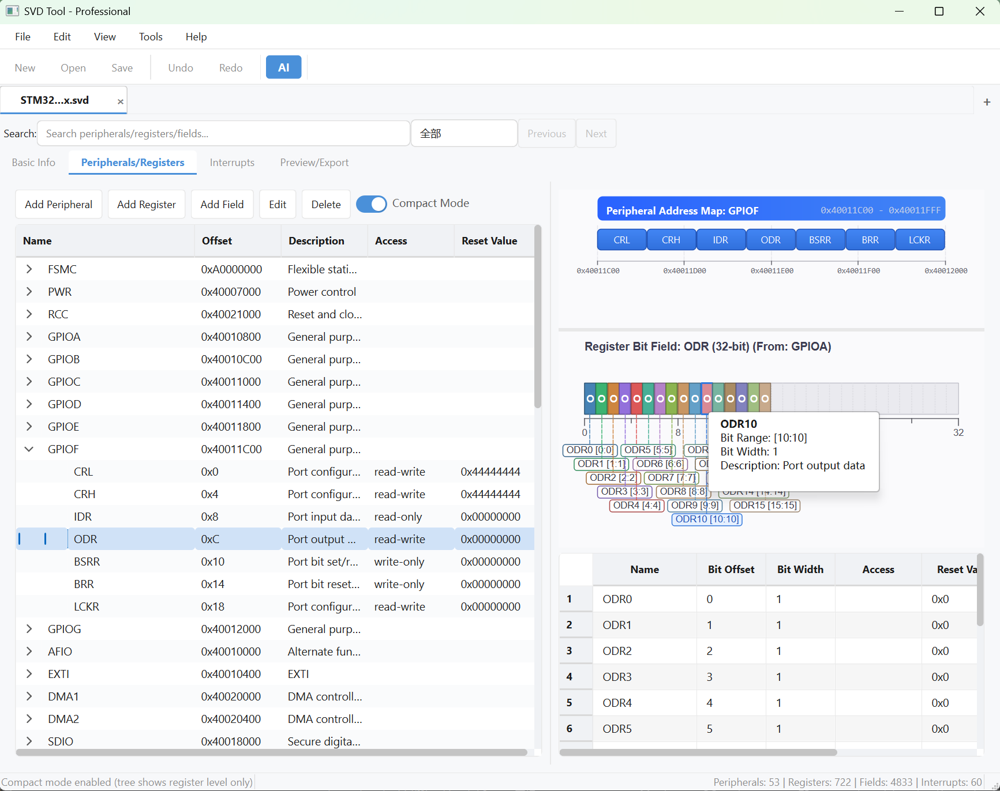
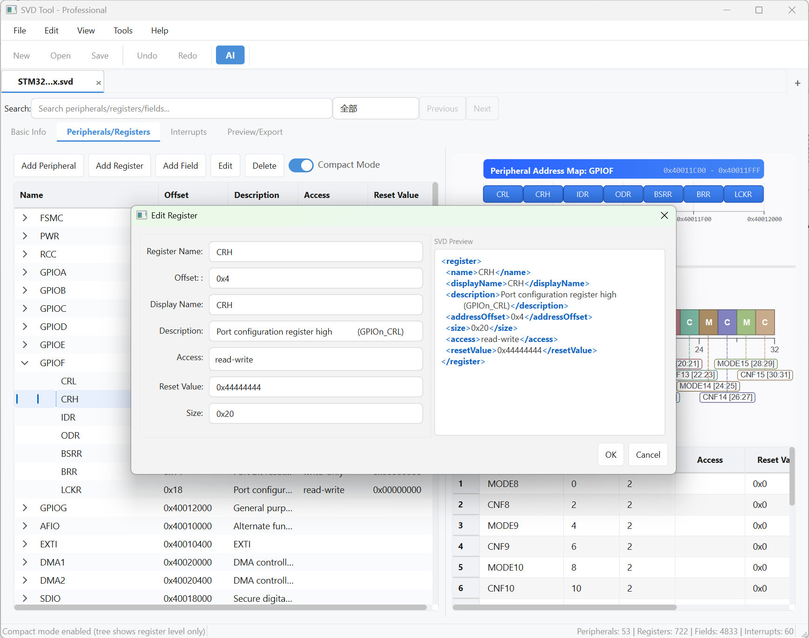

<div align="center">

# SVD Editor

[](README.md)
[](README_zh.md)
[](https://www.python.org/)
[](https://www.riverbankcomputing.com/software/pyqt/)
[](LICENSE)

**专业的 CMSIS-SVD 解析、编辑、可视化和 CLI 工具。支持外设管理、寄存器编辑、位域可视化、批量操作、差异比较/合并、C 头文件生成等。**

[English Version](README.md)

</div>

---

## 截图


*主界面：三级树形结构、地址映射、XML 实时预览*


*位域可视化编辑与寄存器详情*

---

## 功能特性

### GUI 编辑器

| 功能 | 说明 |
|------|------|
| **SVD/XML 解析** | 导入标准 CMSIS-SVD 文件，解析设备/外设/寄存器/位域层次结构 |
| **可视化树形编辑** | 三级树形视图（外设 -> 寄存器 -> 位域），完整增删改查 |
| **继承外设支持** | 自动合并 `derivedFrom` 基类外设的寄存器定义 |
| **地址映射可视化** | 图形化外设地址空间布局和寄存器偏移 |
| **位域可视化** | 寄存器位域图，支持高亮和编辑 |
| **中断管理** | 配置和管理中断向量 |
| **撤销/重做** | 无限操作历史，支持快照恢复 |
| **高级搜索** | 统一搜索语法（`type:periph name:GPIO* addr:0x4001*`），支持结构化和全文搜索 |
| **批量操作** | 批量修改属性、批量生成寄存器、批量克隆到其他外设 |
| **连锁规则** | 级联删除/修改规则，支持可配置的动作类型 |
| **拖放排序** | 直观调整外设和寄存器顺序 |
| **多文档标签** | 打开和切换多个 SVD 文件 |
| **实时预览** | 实时 XML 预览，支持语法高亮 |
| **深色/浅色主题** | 内置主题切换，现代化扁平 UI |
| **dim 寄存器数组** | 支持寄存器级和簇级 `dim`/`dimIncrement`/`dimIndex`（编辑对话框可视化配置）|
| **备选外设/寄存器** | `alternatePeripheral` / `alternateRegister` / `alternateGroup` 可视化编辑；互为备选的地址复用不计冲突 |

### AI 集成（MCP）

内置 AI 面板已移除，改为标准 **MCP Server**：用你自己惯用的 AI 客户端（ZCode / Claude Desktop / Cursor / Cherry Studio / Cline 等）接入，即可用自然语言查询和编辑 SVD。模型、密钥、对话界面都由你的 AI 客户端管理，本工具只提供 30 个标准工具。

**能力覆盖：**

| 能力 | 示例 |
|------|------|
| **查询与搜索** | 设备摘要、外设/寄存器/位域分层获取、统一搜索（分页） |
| **增删改查** | 外设/寄存器/位域/中断的完整 CRUD（支持改名、derivedFrom、alternate 系列、dataType、行为语义等规范元素） |
| **验证检查** | CMSIS-SVD 规范校验、地址冲突检测 |
| **多文档** | 打开/切换/对比多个 SVD 文件 |
| **输出导出** | CSV/Markdown/HTML 文档、C 头文件（普通/CMSIS 风格） |

**工作约定：** 编辑只进内存，`svd_save_document` 才落盘（覆盖前自动 `.bak` 备份）；地址/偏移统一用十六进制字符串。

**接入配置**（三行，各客户端通用）：

```json
{
  "mcpServers": {
    "svd-editor": {
      "command": "python",
      "args": ["C:/path/to/SVDEditor/run.py", "--mcp"],
      "env": { "PYTHONUTF8": "1" }
    }
  }
}
```

详见 [docs/MCP_DESIGN.md](docs/MCP_DESIGN.md)（含工具清单、GUI 实时联动桥规划与分支策略）。

### CLI 命令（可集成 CI/CD）

| 命令 | 说明 |
|------|------|
| `validate` | 验证 SVD 的 CMSIS-SVD Schema 完整性（位域重叠、地址冲突、必需字段等） |
| `export` | 导出为 CSV、Markdown 或 HTML 文档 |
| `generate` | 重新生成/格式化 SVD XML |
| `diff` | 比较两个 SVD 文件的结构差异 |
| `info` | 显示设备信息和统计数据 |
| `merge` | 合并两个 SVD 文件，支持冲突策略配置 |
| `header` | 从 SVD 生成 C 语言头文件 |
| `conflicts` | 检测地址重叠、寄存器偏移重复、位域冲突 |
| `extract` | 从 SVD 中提取指定外设到新文件 |
| `create` | **从 JSON 数据创建新的 SVD 文件**（`DeviceInfo.to_dict()` 格式） |
| `add-peripheral` | 从 JSON 向已有 SVD 添加外设 |
| `update-peripheral` | 更新外设属性（基地址、描述等） |
| `remove-peripheral` | 按名称从 SVD 中移除外设 |
| `add-register` | 向指定外设添加寄存器（JSON 或命令行参数） |
| `update-register` | 更新寄存器属性（偏移、大小、访问权限等） |
| `remove-register` | 按名称从外设中移除寄存器 |
| `add-field` | 向指定寄存器添加位域（JSON 或命令行参数） |
| `update-field` | 更新位域属性（位偏移、位宽、访问权限等） |
| `remove-field` | 按名称从寄存器中移除位域 |

### 输出与导出

- **SVD 生成**：格式规范、缩进整齐的 SVD/XML 输出
- **文档导出**：CSV、Markdown、HTML 寄存器文档
- **C 头文件生成**：寄存器地址宏和位域掩码 `#define`
- **差异报告**：文本或 JSON 格式的差异对比报告

---

## 数据手册资源导入（Excel/Word/PDF → SVD）

集成 [Parser](https://github.com/SamyiHu) 多源解析包，可从芯片数据手册（TRM）和 Excel SFR 表自动生成 SVD，并核对既有 SVD 与手册的一致性。

### 工作流程

```
数据手册（Excel/Word/PDF）→ 解析 → 外设/寄存器/位域 → 导入为 SVD / 核对
```

GUI 入口：**工具菜单 → 从数据手册导入**（`Ctrl+Shift+I`）或工具栏绿色「导入」按钮。

### 三大能力

| 能力 | 说明 |
|------|------|
| **资源导入** | 解析 Excel/Word/PDF 数据手册，自动生成 SVD。支持单源快速导入和多源融合（置信度加权交叉验证）|
| **SVD 核对** | 用手册解析结果对照当前 SVD，逐项找出缺失寄存器/位域、偏移/复位值/访问权限/位宽不符，支持「接受建议」一键修复（可撤销）|
| **封装裁剪分析** | 从 Datasheet 引脚分布表自动推导各封装（LQFP48/64/80）的外设差异，输出裁剪清单（见下文）|

### 多源融合

同时提供 Excel + Word + PDF 三种来源时，按置信度加权融合：
- **交叉验证**：多源一致的属性提升置信度
- **冲突标记**：各源分歧的属性记入 `FusionReport`，可在「工具 → 多源融合审阅」人工裁定
- **置信度色标**：外设树节点标注 high/medium/low/missing，质量一目了然

### Word TRM 三段式解析

针对国产 MCU TRM（SC32/STM32 风格）的寄存器三段式结构做了专门解析器：
1. **寄存器映射表**：含「基地址」+ `|REG|offset|读写|说明|复位值|`，提取外设和寄存器元信息
2. **位域详表**：`####` 寄存器标题后的 `|位编号|位符号|说明|`，提取位域
3. **归一化匹配**：`PWM0_DTx` → `PWMn_DTn`，让位域正确归属寄存器模板

> 比 Parser 原生 Word 解析器准确得多（原生只认单种表，寄存器名常丢失为 UNKNOWN）。

---

## 封装裁剪分析（Datasheet 引脚表 → 各型号 SVD）

同一系列芯片的不同封装（如 LQFP48/64/80）会对外设做阉割（如 ADC 通道数减少、CMP 引脚未引出）。本工具能从 Datasheet 的「管脚资源列表」**自动推导**各封装的裁剪差异。

### 裁剪规则

从引脚表识别每个封装实际引出的外设功能，相对母体（引脚最全的封装）生成裁剪清单：

| 裁剪类型 | 触发条件 | 处理 |
|----------|----------|------|
| **外设级** | 某外设在某封装完全无引脚引出（如 48 脚的 CMP/OP）| 删除整个外设 |
| **实例级** | 外设实例（如 UART1）默认+重映射均无引出 | 删除该实例 |
| **ADC 位域** | AIN 通道数随封装变 | 收窄 `AINx` 位域位宽 |
| **LCD 段码** | SEG 数量随封装变 | 按 1:1 裁剪 SEGR 寄存器 |

> **括号规则**：引脚表里带括号的功能（如 `(RxD2)`）= 引脚重映射，也算可用，不触发删除。

### 示例（SC32L14T/14G）

从 Datasheet 自动分析出的裁剪清单：

```
母体封装: LQFP80

LQFP48 (48脚):
  删外设:     CMP, OP
  删实例:     UART1, UART2, TIM5
  ADC 收窄:   AINx bit[0:19] → bit[0:13]（AIN0~13）
  SEGR 裁剪:  55 → 28 个寄存器

LQFP64 (64脚):
  删实例:     UART4
  ADC 收窄:   AINx → bit[0:17]
  SEGR 裁剪:  55 → 40 个寄存器
```

### API 用法

```python
from svd_tool.core.datasource.pinout_parser import DatasheetPinoutParser

parser = DatasheetPinoutParser()
result = parser.parse_file("SC32L14T_14G_Datasheet.docx")

print(f"母体封装: {result.master_package}")
for spec in result.packages:
    print(f"\n{spec.package_name} ({spec.pin_count}脚):")
    print(f"  删外设: {spec.remove_peripherals}")
    print(f"  删实例: {spec.remove_instances}")
    print(f"  收窄位域: {spec.trim_fields}")
    print(f"  裁寄存器数组: {spec.trim_register_arrays}")
```

> 当前提供裁剪清单分析（`PackageTrimSpec`）。基于母体 SVD 自动生成各封装 SVD 的变体生成器尚在规划中。

---

## dim 寄存器数组支持

完整支持 CMSIS-SVD 规范的 `dim`/`dimIncrement`/`dimIndex` 三件套：

| 层级 | 支持 |
|------|------|
| **Register（寄存器）** | ✅ 数据模型 + 解析 + 生成 + **编辑对话框可视化配置** |
| **Cluster（寄存器簇）** | ✅ 完整支持 |
| **Field（位域）** | 未单独建模；解析时随未知元素透传原文保留（规范极少用）|

寄存器编辑对话框的「寄存器数组 (dim)」分组可勾选启用，配置数量/步长/索引（支持 `0-7` 范围和 `0,1,2` 逗号两种写法），实时预览生成的 dim 标签。

---

## CMSIS-SVD 规范覆盖

对齐 ARM 官方 SVDConv 的能力边界，打开→保存往返不丢数据：

### 位域位置三种等价写法

规范允许 `bitOffset+bitWidth` / `lsb+msb` / `bitRange[msb:lsb]` 三种写法（ST 等厂商常用 lsb+msb），读入统一换算为标准 `bitOffset+bitWidth`，输出标准化。

### 备选（alternate）家族

| 元素 | 层级 | 支持 |
|------|------|------|
| `alternatePeripheral` | 外设 | 建模 + 编辑对话框下拉 + 校验（引用检查、地址重叠豁免） |
| `alternateRegister` / `alternateGroup` | 寄存器 | 建模 + 编辑对话框 + 校验（同外设引用检查、偏移重复豁免） |

互为备选的外设/寄存器共用地址是合法复用：对话框的实时冲突检测**先判断备选关系再报错**，「验证数据」结果中备选关系以「备选外设 / 备选寄存器」信息类目**单列展示**，不混入错误。

### 高频语义元素（建模可编辑）

- **寄存器**：`dataType`、`modifiedWriteValues`、`readAction`
- **位域**：`modifiedWriteValues`、`readAction`；枚举容器 `name`/`headerFileName`/`usage` 与条目 `isDefault`（多枚举容器透传保留）
- **外设**：`version`、`prependToName`、`appendToName`、`headerStructName`、`disableCondition`
- **设备**：`vendorID`、`series`、`licenseText`、`headerSystemFilename`、`headerDefinitionsPrefix`

### 未知元素透传（往返不丢）

解析白名单之外的规范元素（`writeConstraint`、`protection`、`dimName`、`vendorExtensions`、CPU 扩展标志 `fpuDP`/`dspPresent` 等、外设级 dim 系列）**原文保留并在保存时原样回写** —— 规范持续演进也不会静默丢数据。

### 校验（对齐 SVDConv）

中断号范围（0–239）、枚举值缺失/重复/超位宽、dim 一致性（`%s` 占位符 / dimIncrement / dimIndex 数量 / dim=1 警告）、C 标识符合规（豁免 `[%s]` 数组占位符）、备选对共用地址豁免。

---

## 安装与运行

### 环境要求

- Python 3.10+
- PyQt6 6.5.0+

### 快速开始

```bash
git clone https://github.com/SamyiHu/SVDEditor.git
cd SVDEditor
pip install PyQt6
python run.py                # GUI 模式
python run.py info file.svd  # CLI 模式
```

### 数据手册导入配置（可选）

数据手册导入功能依赖外部 [Parser](../Parser) 包（包名 `reg_core`，桥接自动探测：pip 安装 / 仓库同级 `../Parser` / 环境变量 `SVDEDITOR_PARSER_PATH` 指向含 `reg_core/` 的目录）及其解析库。缺失时不影响编辑器主体，导入向导会提示安装：

```bash
# Parser 包（推荐 editable 安装）
pip install -e ../Parser

# Parser 的解析依赖
pip install openpyxl python-docx pdfplumber pymupdf pyyaml

# pandoc（Word TRM 三段式解析推荐安装，用于 docx→markdown 转换）
# 从 https://pandoc.org 安装，或 winget install pandoc
```

### MCP Server 配置（AI 客户端接入）

```bash
# 安装可选的 MCP 依赖
pip install mcp            # 或 pip install -r requirements-mcp.txt

# 启动方式（二选一）
python run.py --mcp        # 源码直接运行
python -m svd_tool.mcp_server
```

客户端接入配置见上文「AI 集成（MCP）」章节。Windows 下建议设置 `PYTHONUTF8=1`。

---

## CLI 使用

<details>
<summary><b>基础命令</b></summary>

```bash
# 验证
python run.py validate chip.svd [--json] [--strict]

# 导出文档
python run.py export chip.svd --format markdown -o registers.md
python run.py export chip.svd --format csv --peripheral GPIOA --summary-only

# 重新生成 SVD
python run.py generate chip.svd -o output.svd

# 比较两个版本
python run.py diff chip_v1.svd chip_v2.svd [--json] [--ignore-description]

# 设备信息
python run.py info chip.svd [--json]

# 合并 SVD 文件
python run.py merge target.svd source.svd --strategy source -o merged.svd

# 生成 C 头文件
python run.py header chip.svd --style upper_case --prefix CHIP_ -o device.h

# 检查地址冲突
python run.py conflicts chip.svd [--json] [--strict]

# 提取外设
python run.py extract chip.svd --peripherals GPIOA,GPIOB,GPIOC -o gpio.svd
```

</details>

<details>
<summary><b>高级命令</b></summary>

```bash
# 从 JSON 创建 SVD（DeviceInfo.to_dict() 格式）
python run.py create --data device_data.json -o chip.svd [--validate] [--open]

# 从 JSON 添加外设
python run.py add-peripheral chip.svd --data peripheral.json -o updated.svd

# 移除外设
python run.py remove-peripheral chip.svd --name GPIOC,GPIOD -o updated.svd

# 更新外设属性
python run.py update-peripheral chip.svd -n GPIOA --base-address 0x48010000 -o updated.svd

# 设置备选外设（共用地址块的合法复用，豁免冲突检查）
python run.py update-peripheral chip.svd -n GPIOA --alternate-peripheral GPIOB -o updated.svd

# 添加寄存器（命令行参数）
python run.py add-register chip.svd -p GPIOA --name IDR --offset 0x10 --desc "Input data" -o updated.svd

# 添加寄存器（JSON 文件）
python run.py add-register chip.svd -p GPIOA --data registers.json -o updated.svd

# 更新寄存器属性
python run.py update-register chip.svd -p GPIOA -n MODER --offset 0x08 --size 0x20 -o updated.svd

# 设置备选寄存器 / 备选组（同一外设内，互为备选共用偏移不计冲突）
python run.py update-register chip.svd -p GPIOA -n CRL --alternate-register CRH --alternate-group CFG -o updated.svd

# 移除寄存器
python run.py remove-register chip.svd -p GPIOA --names OTYPER,OSPEEDR -o updated.svd

# 添加位域（命令行参数）
python run.py add-field chip.svd -p GPIOA -r MODER --name MODE7 --bit-offset 14 --bit-width 2 -o updated.svd

# 更新位域属性
python run.py update-field chip.svd -p GPIOA -r MODER -n MODE0 --bit-width 1 --access read-write -o updated.svd

# 移除位域
python run.py remove-field chip.svd -p GPIOA -r MODER --names MODE0,MODE1 -o updated.svd
```

</details>

<details>
<summary><b>GUI 模式</b></summary>

```bash
# 使用 GUI 打开指定文件
python run.py --gui --file chip.svd
```

</details>

---

## 键盘快捷键（GUI）

| 快捷键 | 功能 |
|--------|------|
| `Ctrl+N` | 新建 SVD 文件 |
| `Ctrl+O` | 打开文件 |
| `Ctrl+S` | 保存文件 |
| `Ctrl+Z` | 撤销 |
| `Ctrl+Y` | 重做 |
| `Ctrl+F` | 快速搜索 |
| `Ctrl+H` | 高级搜索 |
| `Ctrl+Shift+G` | 跳转到地址 |
| `F5` | 刷新视图 |

---

## 项目结构

```
SVDEditor/
├── run.py                          # 入口（GUI + CLI）
├── svd_tool/
│   ├── cli.py                      # CLI 模块（19 个命令）
│   ├── main.py                     # GUI 入口
│   ├── core/
│   │   ├── data_model.py           # 数据模型
│   │   ├── svd_parser.py           # SVD 解析器
│   │   ├── svd_generator.py        # SVD 生成器
│   │   ├── svd_schema_validator.py # Schema 验证
│   │   ├── svd_exporter.py         # CSV/Markdown/HTML 导出
│   │   ├── svd_differ.py           # 差异比较引擎
│   │   ├── svd_merger.py           # 合并引擎
│   │   ├── header_generator.py     # C 头文件生成器
│   │   ├── address_conflict_detector.py  # 冲突检测
│   │   ├── chain_rules.py          # 连锁规则引擎
│   │   ├── document_manager.py     # 多文档管理
│   │   ├── command_history.py      # 撤销/重做
│   │   └── datasource/             # 数据手册集成核心层
│   │       ├── parser_bridge.py        # Parser(reg_core) 包桥接（线程封装）
│   │       ├── trm_parser.py           # Word TRM 三段式解析器
│   │       ├── chip_to_svd_converter.py # ChipData → DeviceInfo
│   │       ├── svd_verifier.py         # SVD 核对引擎
│   │       ├── pinout_parser.py        # Datasheet 引脚表 → 封装裁剪清单
│   │       ├── header_parser.py        # H 头文件解析（H 主控链路）
│   │       ├── header_coverage.py      # H/TRM/SVD 覆盖率统计
│   │       ├── header_trm_fusion.py    # H 与 TRM 融合
│   │       ├── correction_store.py     # 修正数据存储
│   │       └── review_workflow.py      # 修正审阅工作流
│   ├── mcp_server/                 # MCP Server（AI 客户端接入，无 PyQt 依赖）
│   │   ├── server.py                   # 30 个 MCP 工具定义 + stdio 入口
│   │   └── headless_workspace.py       # headless 多文档工作区（编辑→显式保存）
│   ├── ui/
│   │   ├── main_window_refactored.py     # 主窗口
│   │   ├── components/                   # 组件目录
│   │   │   ├── state_manager.py          # 状态管理
│   │   │   ├── layout_manager.py         # 布局协调
│   │   │   ├── tab_builder.py            # 标签页构建
│   │   │   └── menu_bar.py / toolbar.py  # 菜单和工具栏
│   │   ├── managers/                     # 管理器目录
│   │   │   ├── search_manager.py         # 搜索（快速+高级）
│   │   │   ├── batch_operations_manager.py  # 批量操作
│   │   │   ├── datasource_manager.py     # 数据手册导入/核对调度
│   │   │   ├── command_executor.py       # 结构化操作执行器（MCP GUI 桥的操作层）
│   │   │   └── file_operations.py        # 文件 I/O
│   │   ├── dialogs/                      # 对话框目录
│   │   │   ├── chain_rules_dialog.py     # 连锁规则编辑器
│   │   │   ├── svd_diff_merge_dialog.py  # 差异比较与合并
│   │   │   ├── new_svd_wizard.py         # 新建文件向导
│   │   │   ├── import_wizard.py          # 数据手册导入向导
│   │   │   ├── fusion_review_dialog.py   # 多源融合审阅
│   │   │   └── svd_verify_dialog.py      # SVD 核对面板
│   │   └── widgets/                      # 控件目录
│   │       ├── bit_field_widget.py       # 位域可视化
│   │       ├── address_map_widget.py     # 地址映射
│   │       ├── document_tab_bar.py       # 多文档标签
│   │       └── welcome_page.py           # 欢迎页
│   ├── config/
│   │   ├── about.json              # 关于对话框配置
│   │   └── styles.py               # 主题/样式系统（深色/浅色）
│   └── i18n/
│       ├── i18n.py                 # 国际化管理器
│       ├── zh_CN.json              # 中文翻译
│       └── en_US.json              # 英文翻译
├── docs/                           # 文档
├── build_tools/                    # PyInstaller 构建脚本
├── test_data/                      # 测试 SVD 文件
└── tests/                          # 测试套件
```

---

## 构建

详见 [BUILD_INSTRUCTIONS.md](docs/BUILD_INSTRUCTIONS.md)。

```bash
pip install pyinstaller
cd build_tools
python build_professional_fixed.py
```

---

## 许可证

GNU General Public License v3.0 - 详见 [LICENSE](LICENSE)。

## 维护者

- SamyiHu ([@SamyiHu](https://github.com/SamyiHu))

---

<div align="center">

**感谢使用 SVD Editor！**

[](README.md)
[](README_zh.md)

</div>
